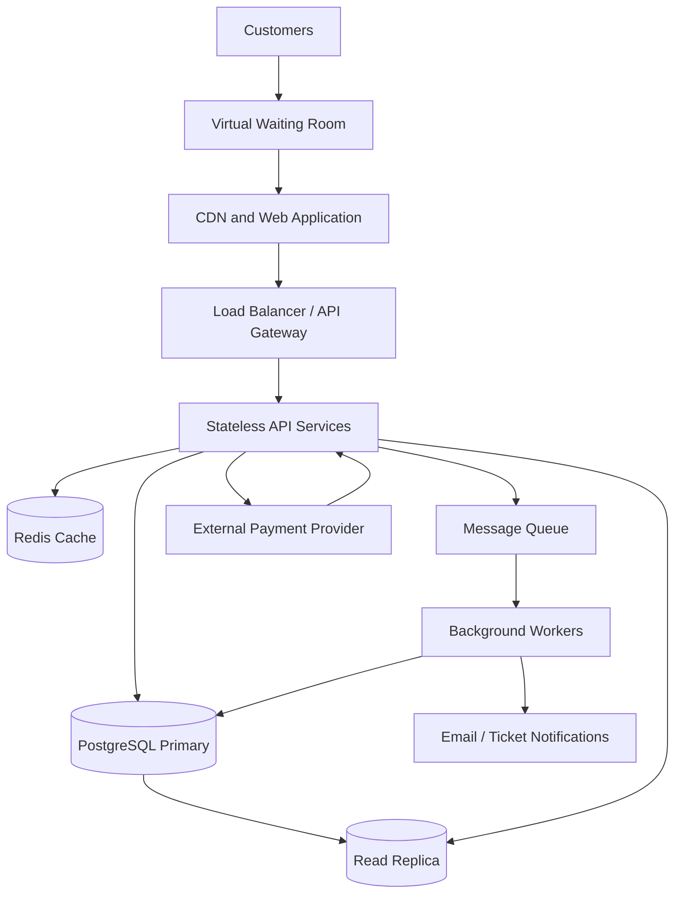

# TicketHub — System Design

## 1. Requirements

### Functional requirements
1. Users can register, sign in, and manage their profiles.
2. Visitors can browse, search, and filter events by title, date, venue, and location.
3. Visitors can view an event's seat map and see available, held, and sold seats.
4. Signed-in users can temporarily hold available seats.
5. Users can pay for an order and receive confirmation.
6. Users can view current and past orders and retrieve their tickets.
7. Administrators can create events, configure seats, and monitor sales.

### Non-functional requirements

| Area | Requirement |
|---|---|
| Speed | Event pages and seat maps should normally load within 2 seconds. |
| Correctness | A seat must never be sold twice. Holds, orders, and seat changes must use database transactions and constraints. |
| Fairness | High-demand sales use a virtual waiting room, queue tokens, and controlled admission. Automated clients must not bypass the queue. |
| Availability | Browsing should remain available during a sale. If booking or payment is unhealthy, fail safely rather than confirm an uncertain purchase. |
| Security | Use HTTPS, authentication, input validation, rate limits, audit logs, and a payment provider. Do not store raw card details. |
| Scalability | Scale stateless API instances horizontally; cache read-heavy event information; keep inventory decisions strongly consistent. |
| Recovery | Back up the database and make callbacks and background jobs retryable and idempotent. |

Correctness is more important than accepting every request: a fast sale is not successful if customers are charged for seats they cannot receive.

## 2. Traffic estimates

### Normal day
- Visitors: 50,000 per day.
- Page views: 50,000 × 10 = **500,000 per day**.
- Average page views per second: 500,000 ÷ 86,400 = **about 5.8 per second**.
- Ticket sales: 5,000 per day.
- Average sales per second: 5,000 ÷ 86,400 = **about 0.058 per second**.

These are 24-hour averages. Actual daytime and event-related peaks will be higher, so the system should be load-tested above these averages.

### Popular concert sale
- People trying to buy: 200,000 in 10 minutes.
- Seats available: 20,000.
- Average purchase attempts: 200,000 ÷ 600 = **about 333 attempts per second**.
- Average seat sales needed to sell all seats in 10 minutes: 20,000 ÷ 600 = **about 33 seats per second**.
- Demand is **10 times the inventory**.

The 333 attempts/second figure is only the ten-minute average; the first seconds may be much busier. A waiting room is therefore necessary. The system cannot promise a ticket to everyone.

| Measure | Normal day | Popular sale |
|---|---:|---:|
| Visitors / interested buyers | 50,000 per day | 200,000 in 10 minutes |
| Page views | 500,000 per day | Not specified |
| Average page views / attempts | 5.8 per second | 333 purchase attempts per second |
| Tickets / seats | 5,000 sold per day | 20,000 seats total |
| Main pressure | Routine browsing and purchases | Sudden competition for limited seats |

The big sale concentrates demand into a short period. Browsing and seat allocation must be handled differently so that a spike in page views does not overwhelm the inventory database.

## 3. API design

All endpoints use HTTPS and JSON. Authenticated endpoints require an access token. Operations that may be retried accept an `Idempotency-Key` header.

| Method and endpoint | Purpose | Success | Important errors |
|---|---|---|---|
| `GET /api/events?search=&date=` | Browse and filter events | `200 OK` | `400 Bad Request` |
| `GET /api/events/{eventId}` | View event details | `200 OK` | `404 Not Found` |
| `GET /api/events/{eventId}/seats` | View seat map and availability | `200 OK` | `404 Not Found` |
| `POST /api/seat-holds` | Temporarily hold selected seats | `201 Created` | `409 Conflict`, `401 Unauthorized`, `422 Unprocessable Content` |
| `POST /api/orders` | Create an order from a valid hold | `201 Created` | `409 Conflict`, `422 Unprocessable Content` |
| `POST /api/orders/{orderId}/payment` | Start payment | `202 Accepted` | `404 Not Found`, `409 Conflict`, `502 Bad Gateway` |
| `GET /api/me/tickets` | View the signed-in user's tickets | `200 OK` | `401 Unauthorized` |
| `GET /api/orders/{orderId}` | View order and payment status | `200 OK` | `401 Unauthorized`, `403 Forbidden`, `404 Not Found` |

### Example: hold seats

```http
POST /api/seat-holds
Authorization: Bearer <access-token>
Idempotency-Key: 9d1c-example
Content-Type: application/json
```

```json
{
  "eventId": 42,
  "seatIds": [501, 502]
}
```

Response:

```json
{
  "holdId": "hold_8f31",
  "status": "held",
  "seatIds": [501, 502],
  "expiresAt": "2026-11-01T10:05:00Z"
}
```

If either seat is no longer available, return `409 Conflict` and hold neither seat. A multi-seat request is all-or-nothing.

### Example: start payment

```http
POST /api/orders/9001/payment
Authorization: Bearer <access-token>
Idempotency-Key: pay-9001-1
Content-Type: application/json
```

```json
{
  "paymentMethodToken": "provider-token"
}
```

The API may return `202 Accepted` while the payment provider processes the payment. A verified provider callback updates the order. Callback signatures must be verified and duplicate callbacks handled idempotently.

## 4. Data model

PostgreSQL is suitable because seat allocation requires transactions, constraints, and consistent updates.

### Tables and relationships
- **users:** one user can place many orders.
- **events:** one event has many seats and many orders.
- **seats:** each row is one sellable seat for one event.
- **orders:** each order belongs to one user and one event.
- **order_seats:** joins orders to seats; a seat can belong to at most one order.
- **payments:** records payment attempts for an order.

### Simplified PostgreSQL schema

```sql
CREATE TABLE users (
    id BIGSERIAL PRIMARY KEY,
    email VARCHAR(255) NOT NULL UNIQUE,
    full_name VARCHAR(150) NOT NULL,
    created_at TIMESTAMPTZ NOT NULL DEFAULT NOW()
);

CREATE TABLE events (
    id BIGSERIAL PRIMARY KEY,
    title VARCHAR(200) NOT NULL,
    venue VARCHAR(200) NOT NULL,
    starts_at TIMESTAMPTZ NOT NULL,
    sales_open_at TIMESTAMPTZ,
    status VARCHAR(20) NOT NULL
      CHECK (status IN ('draft', 'on_sale', 'sold_out', 'cancelled'))
);

CREATE TABLE seats (
    id BIGSERIAL PRIMARY KEY,
    event_id BIGINT NOT NULL REFERENCES events(id),
    section VARCHAR(80) NOT NULL,
    seat_label VARCHAR(30) NOT NULL,
    price NUMERIC(10,2) NOT NULL CHECK (price >= 0),
    status VARCHAR(20) NOT NULL DEFAULT 'available'
      CHECK (status IN ('available', 'held', 'sold')),
    held_by_user_id BIGINT REFERENCES users(id),
    hold_expires_at TIMESTAMPTZ,
    UNIQUE (event_id, seat_label),
    UNIQUE (id, event_id)
);

CREATE TABLE orders (
    id BIGSERIAL PRIMARY KEY,
    user_id BIGINT NOT NULL REFERENCES users(id),
    event_id BIGINT NOT NULL REFERENCES events(id),
    status VARCHAR(20) NOT NULL
      CHECK (status IN ('pending', 'awaiting_payment', 'paid', 'expired', 'cancelled')),
    total_amount NUMERIC(10,2) NOT NULL CHECK (total_amount >= 0),
    created_at TIMESTAMPTZ NOT NULL DEFAULT NOW(),
    hold_expires_at TIMESTAMPTZ
);

CREATE TABLE order_seats (
    order_id BIGINT NOT NULL REFERENCES orders(id),
    seat_id BIGINT NOT NULL REFERENCES seats(id),
    event_id BIGINT NOT NULL REFERENCES events(id),
    PRIMARY KEY (order_id, seat_id),
    UNIQUE (seat_id),
    FOREIGN KEY (seat_id, event_id) REFERENCES seats(id, event_id)
);

CREATE TABLE payments (
    id BIGSERIAL PRIMARY KEY,
    order_id BIGINT NOT NULL REFERENCES orders(id),
    provider_reference VARCHAR(150) UNIQUE,
    idempotency_key VARCHAR(150) NOT NULL UNIQUE,
    amount NUMERIC(10,2) NOT NULL CHECK (amount >= 0),
    status VARCHAR(20) NOT NULL
      CHECK (status IN ('pending', 'succeeded', 'failed', 'refunded')),
    created_at TIMESTAMPTZ NOT NULL DEFAULT NOW()
);

CREATE INDEX idx_events_starts_at ON events(starts_at);
CREATE INDEX idx_seats_event_status ON seats(event_id, status);
CREATE INDEX idx_orders_user_created ON orders(user_id, created_at DESC);
CREATE INDEX idx_orders_event_status ON orders(event_id, status);
```

`UNIQUE (event_id, seat_label)` prevents duplicate seat definitions within an event. `UNIQUE (seat_id)` in `order_seats` prevents one seat from being assigned to two orders. Application transactions and seat-status checks provide another layer of protection.

## 5. Preventing double-booking

The database is the source of truth. A seat map shown in a browser can become outdated immediately, so the server must re-check availability when a customer requests a hold.

1. Start a database transaction.
2. Lock the requested seat rows with `SELECT ... FOR UPDATE`, always locking multiple seats in ascending seat-ID order.
3. Check that every requested seat is available, or that its previous hold has expired.
4. If any seat is unavailable, roll back and return `409 Conflict`.
5. Otherwise, create the hold/order records and update all requested seats to `held`, recording the user and a short expiry (for example, five minutes).
6. Commit the transaction.

If two customers request the same seat, the second transaction waits for the first row lock. After the first transaction commits, the second sees the seat is held and cannot claim it. The unique constraint on `order_seats.seat_id` is an additional safeguard against assigning that seat to two orders.

When payment is confirmed, the server verifies the payment-provider callback, locks the order and seats, checks the hold, and changes the seats to `sold` and order to `paid` in a transaction. Idempotency keys and unique provider references prevent duplicate payment processing. If payment fails or the hold expires, a background worker releases the seats to `available`.

For a request containing several seats, all seats are held or none are held. This avoids partial bookings. A short hold gives customers time to pay without allowing abandoned checkouts to block inventory indefinitely.

## 6. Architecture



### Components
- **Virtual waiting room:** Queues visitors during major sales, issues short-lived entry tokens, and admits customers at a controlled rate. This reduces overload and makes access more orderly.
- **CDN and web application:** Serves static files and images close to customers, reducing API traffic.
- **Load balancer / API gateway:** Distributes requests across API instances, handles TLS, validates tokens, and applies rate limits.
- **Stateless API services:** Handle event browsing, seat maps, holds, orders, and ticket retrieval. Instances can scale horizontally.
- **Redis cache:** Caches event descriptions, venue details, and other read-heavy information. Cached seat status is informational only; the primary database decides whether a hold succeeds.
- **PostgreSQL primary:** Stores authoritative seat, hold, order, and payment state. Transactions, row locks, and constraints protect inventory.
- **Read replica:** Handles suitable read-only traffic, such as event listings and order history. Booking decisions never use potentially stale replica data.
- **Message queue and workers:** Process callbacks, expire holds, send tickets, and retry temporary failures outside the customer request.
- **Payment provider:** Processes payments. TicketHub stores provider references and statuses, not raw card details.
- **Monitoring and alerts:** Track latency, database lock waits, queue length, payment failures, and inventory.

### Surviving the big sale

The waiting room absorbs the initial burst of 200,000 interested customers and controls how many reach checkout at once. The CDN and Redis cache serve event information without sending every page request to PostgreSQL. Stateless API instances can be scaled horizontally. The primary database handles seat holds and sales because it must make consistent decisions. Workers handle slower tasks such as notifications and hold expiry. If the database cannot safely process a hold, TicketHub rejects or queues the request instead of risking a double sale.

## 7. Trade-offs

### 1. Strong consistency versus maximum throughput
Transactions and row locks make seat allocation correct, but requests competing for the same seat may wait. This is acceptable because selling a seat twice is worse than briefly slowing a booking. Caching and queue admission reduce unnecessary database pressure.

### 2. Waiting-room fairness versus instant access
A waiting room makes a major sale more orderly and protects the system, but customers may wait even while the site is responsive. A clear queue position and published admission policy improve transparency. Repeated refreshing should not give a customer an advantage.

### 3. Temporary holds versus inventory utilisation
A five-minute hold gives customers time to pay, but abandoned checkouts temporarily block seats. Short expirations and automatic release improve utilisation; a visible countdown tells customers how much time remains. The hold duration can be adjusted using real booking data.

## Conclusion

TicketHub separates high-volume browsing from the strongly consistent booking process. A waiting room, caching, horizontally scaled API services, and background workers help absorb the sale spike. Transactions, row locks, and unique constraints ensure that each seat can be sold only once.
